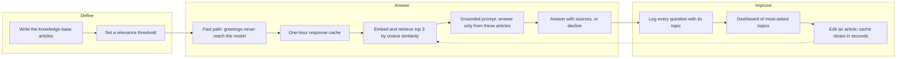

# Sagarika Chakraborty

Technical lead and full stack .NET engineer in Bangalore. I build C#, ASP.NET Core, React and SQL Server systems, and I have put retrieval augmented generation into production.

Six years across banking, OTT/DTH, real estate and healthcare clients, most recently a server migration for a Swiss bank at Wipro and a subscriber platform at DishTV. Outside engineering, I wrote The Journey of a Mother, the memoir behind the film Mrs. Chatterjee vs Norway.

## AI stack

## Building with AI

How a support question becomes a grounded answer, and how the system stays cheap and current once it is live.

- **In production at DishTV:** a consumer portal chatbot on Semantic Kernel and Azure OpenAI (GPT-4o-mini), answering subscriber questions from a SQL Server knowledge base. Intent routing, the response cache and lighter queries cut its AI API cost by ~90%.
- **Run it yourself:** [ConsumerChatbot](https://github.com/sagarai2024-collab/ConsumerChatbot) is a clean-room rebuild of that design. [Phoenix-Watcho](https://github.com/sagarai2024-collab/Phoenix-Watcho) moves the vectors into Supabase pgvector behind an HNSW index and switches between Gemini and OpenAI.
- **What I hold to:** the model answers only from retrieved articles and says so when it finds nothing; the cheap path runs first; any knowledge-base edit clears the cache, so nobody gets a stale answer.

## Worth opening

**Code** runs with `dotnet run`. **Case study** is a design write-up (HLD, LLD, diagram) for client work whose code I can't publish.

- [ConsumerChatbot](https://github.com/sagarai2024-collab/ConsumerChatbot) **Code.** RAG support chatbot in .NET 9 with a fast-path router, one-hour cache, live knowledge-base edits and an offline mode that needs no keys.
- [Phoenix-Watcho](https://github.com/sagarai2024-collab/Phoenix-Watcho) **Code.** DTH self-care portal (React 19, ASP.NET Core 9, EF Core 9): plans, expiry, itemized GST billing, KYC upload, and a RAG assistant on Supabase pgvector.
- [notification-api](https://github.com/sagarai2024-collab/notification-api) **Code.** Email notification service where parallel workers cannot claim the same row, duplicates collapse under `sp_getapplock`, and failed sends retry with back-off. 58 tests.
- [Movie on Demand](https://github.com/sagarai2024-collab/project-case-studies/tree/main/movie-on-demand) **Case study.** OTT catalogue and slot booking at DishTV, synced across DishTV and D2H with Azure Functions, images in Blob Storage.
- [MDM master data](https://github.com/sagarai2024-collab/project-case-studies/tree/main/mdm-master-data) **Case study.** Supplier and customer onboarding with approval workflow, synced to SAP through Dell Boomi and Ariba, for four global regions.
- [NPI-FMRS](https://github.com/sagarai2024-collab/project-case-studies/tree/main/npi-fmrs) **Case study.** Property inspection platform for a US client, with owner, inspector and bidding modules on a four-layer clean architecture.
- [EIS Americas FMRS](https://github.com/sagarai2024-collab/project-case-studies/tree/main/eis-americas-fmrs) **Case study.** Equipment installation jobs for contractors and installers, tracked from assignment to review with before and after photos.
- [WCDP workforce](https://github.com/sagarai2024-collab/project-case-studies/tree/main/wcdp-workforce) **Case study.** Xamarin timesheet and task apps for Android, iOS and Windows, with offline sync.
- [DevOps automation](https://github.com/sagarai2024-collab/project-case-studies/tree/main/devops-automation) **Case study.** Azure DevOps YAML pipelines with PIM approval gates and staging to production slot swaps.
- [GTPL Cable](https://github.com/sagarai2024-collab/project-case-studies/tree/main/gtpl-cable) **Case study.** Cable TV subscriber portal with plans, online recharge and RDLC billing reports.
- [CSIWB membership](https://github.com/sagarai2024-collab/project-case-studies/tree/main/csiwb-membership) **Case study.** Membership lifecycle and newsletters for a cardiology society.
- [Sudarshan student portal](https://github.com/sagarai2024-collab/project-case-studies/tree/main/sudarshan-student-portal) **Case study.** Student registration, online fees and study material access.
- [Gyrate Netcom](https://github.com/sagarai2024-collab/project-case-studies/tree/main/gyrate-netcom) **Case study.** Online grocery store on ASP.NET MVC 5: catalogue, cart, checkout and order tracking.
- [Smart Visa](https://github.com/sagarai2024-collab/project-case-studies/tree/main/smart-visa) **Case study.** Visa application portal on DNN with Telerik, from my 2018 internship.

All case studies are indexed in [project-case-studies](https://github.com/sagarai2024-collab/project-case-studies).

## Elsewhere

[LinkedIn](https://www.linkedin.com/in/sagarika-chakraborty-017530111) · sagarai2024@gmail.com

Happy to talk about RAG in .NET, cost control for LLM apps, or any of the projects above.
